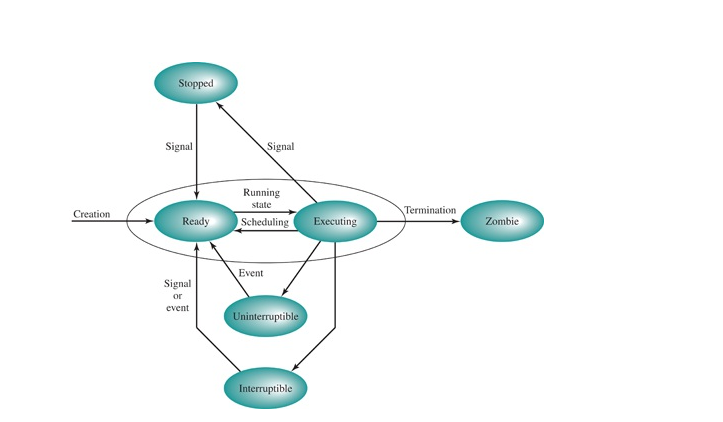

# Na podstawie rysunku 4.15 z §4.6 przedstaw stany procesu w systemie Linux.
Podaj akcje albo zdarzenia wyzwalające zmianę stanu. Które przejścia mogą być rezultatem działań podejmowanych przez: jądro
systemu operacyjnego, kod sterowników, proces użytkownika? Wyjaśnij różnice między snem przerywalnym
i nieprzerywalnym. Czy proces może zablokować lub zignorować sygnał «SIGKILL» lub «SIGSEGV»?

Kernel : wybor procesu z kolejki skoncenczenie sie czasu i oddanie go innemu, zabicie procesu przez jakis nieobsluzony 

### Widzimy, że gdy proces jest tworzony to ma status Ready. Podczas działania ma running, może zostać uśpiony zatrzymywalnie gdy czeka na jakiś event np. zakończenie operacji I/O, lub niezatrzymywalnie, może zostać został również zatrzymany np. podczas debugowania. Gdy jest zatrzymany i go znowu odpalimy dzięki sygnałowi to znowu jest Ready. Gdy proces jest terminowany to dostaje status Zombie.

### Różnica miedzy snem przerywalnym lub nieprzerywalnym
Oba te stany mówią nam o tym, że proces jest zablokowany, ale różnica jest taka, że podczas snu nieprzerywalnego proces czeka odpowiedź z hardware'u i nie jest w stanie obsługiwać sygnałów.

##### Zignorowanie procesu oznacza, to że proces informuje jądro że dany sygnał jest dla niego bezznaczenia i jądro nie reaguje  
Natomiast zablokowanie to tak naprawdę odłożenie sygnału na później, dostaje on wówczas status pending i będzie obsłużony gdy proces zdecydujej się na odblokowanie

#### Sigkill nie można ani zablokować ani zignorować ani przechwycić, jest on przekazywany bezpośrednio do jądra systemu i proces nie wie że ten sygnał przyszedł

SigSegv czy segmentation fault, można i zablokować i zignorować, ale skutki są często niepożądane: jeśli został wywowały sprzętowo np. poprzez odczyt niedozwolonej pamięci, system po takim sygnale bedzie chciał wznowić działanie procesu od linijki która go wywołała, gdy sygnał zostanie zignorowany to sytuacja bedzie sie w nieskończoność powtarzała 